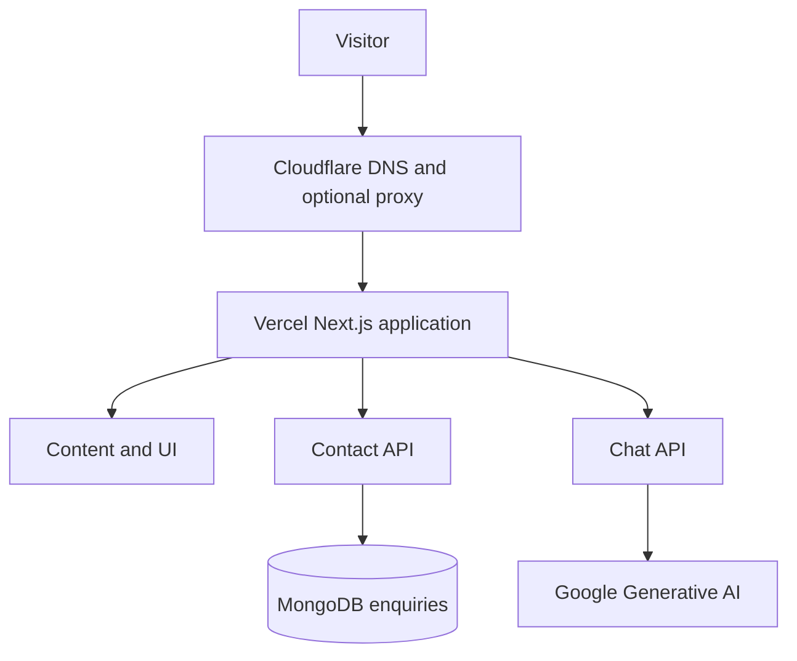

# System architecture

## Scope

This is a public marketing and editorial application. Most routes are statically renderable; the contact and chat handlers require server-side services. It has no authenticated customer portal, no internal administration area and no persistent chat sessions.

Cloudflare handles traffic and edge controls when configured. Vercel is the only application origin. A separate Workers Build connected to this repository risks conflicting deployments and must be disconnected in the Cloudflare dashboard.

## Runtime boundaries

**Content routes:** `src/app/` contains the landing page, service information, company overview, blog, portfolio, brochure, careers, privacy, terms and a workflow estimator. Article and project details are sourced from typed TypeScript arrays. A source link is not a substitute for performance evidence.

**Shared UI:** `src/components/layout` owns primary navigation and site chrome. Other components add interaction and animations. Heavy effects must respect reduced motion and must not obscure core navigation or content.

**Contact route:** `POST /api/contact` validates JSON against a strict Zod schema, drops known spam-trap submissions without database insertion and stores accepted enquiries in MongoDB. There is no notification queue or email delivery in this repository: a successful response means the database insert succeeded, **not** that a staff member received an email.

**Chat route:** `POST /api/chat` validates the message and calls the configured provider. The widget submits only the latest user message. There is no long-term conversation memory, retrieval-augmented knowledge base, human handover system or guarantee that a generated answer is factual. The key and model are server-side settings.

**Request boundaries:** `src/lib/request-json.ts` validates the Origin when supplied, enforces JSON content type and caps the number of bytes actually read from a request stream. Validation is not authentication or rate limiting.

## Data and operational responsibilities

- Protect `MONGODB_URI` and the provider key in Vercel settings.
- Set MongoDB network access, least privilege, retention and backup procedures in the database service.
- Set and verify edge rate limiting for `/api/chat` and `/api/contact`.
- Keep previews separate from production and never use real customer records as test data.
- Validate site content and source evidence each time the portfolio repositories change.

## Editing rules

Keep page responsibilities clear, avoid adding duplicate systems for the same interaction, and prefer native accessible controls over animated controls with no semantic purpose. For changes to a runtime endpoint, add a repeatable test and update [API docs](api.md). For any public copy about a project, update the evidence register with its actual status.
